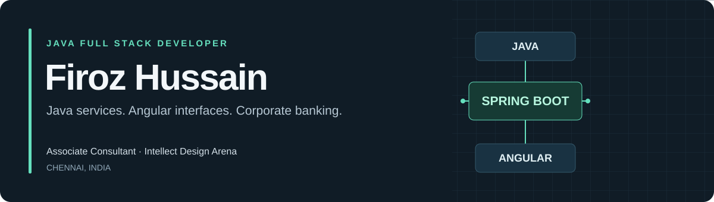

  

  
  
  

I'm an **Associate Consultant at Intellect Design Arena**, building corporate banking applications with Java, Spring Boot, and Angular. Based in Chennai, I work across REST APIs, reusable interfaces, and Oracle/PostgreSQL databases.

<table>
  <tr>
    <td align="center" width="25%"><h3>2+ years</h3>Enterprise experience</td>
    <td align="center" width="25%"><h3>50+ APIs</h3>Production REST endpoints</td>
    <td align="center" width="25%"><h3>100+ components</h3>Reusable Angular UI</td>
    <td align="center" width="25%"><h3>90%+ coverage</h3>Assigned microservices · JaCoCo</td>
  </tr>
</table>

## What I work on

- **Banking services:** Java and Spring Boot APIs with input validation, role-based controls, and Angular integration.
- **Liquidity workflows:** asynchronous processing, Sweep and Pool Sweep mechanisms, and Maker-Checker authorization.
- **Reliable delivery:** JUnit tests, Oracle/PostgreSQL migration support, and resolving defects across application layers.

## Selected projects

<table>
<tr>
<td width="50%" valign="top">
<h3><a href="https://github.com/Firoz1212/Spring-Boot-Employee-Management-System">Employee Management System</a></h3>

Employee CRUD workflows backed by REST APIs and persistent MySQL storage.

<code>Java</code> <code>Spring Boot</code> <code>React</code> <code>MySQL</code>

<a href="https://github.com/Firoz1212/Spring-Boot-Employee-Management-System">Explore source →</a>
</td>
<td width="50%" valign="top">
<h3><a href="https://github.com/Firoz1212/Interview-App">Interview App</a></h3>

A public interview-preparation application built with Angular.

<code>Angular</code> <code>TypeScript</code> <code>HTML</code> <code>CSS</code>

<a href="https://github.com/Firoz1212/Interview-App">Explore source →</a>
</td>
</tr>
<tr>
<td width="50%" valign="top">
<h3><a href="https://firoz1212.github.io/firoz-portfolio/">Developer portfolio</a></h3>

Career background, technical skills, and conceptual summaries of corporate banking engagements.

<code>HTML</code> <code>CSS</code> <code>JavaScript</code>

<a href="https://firoz1212.github.io/firoz-portfolio/">Visit portfolio →</a> · <a href="https://github.com/Firoz1212/firoz-portfolio">Source</a>
</td>
<td width="50%" valign="top">
<h3><a href="https://github.com/Firoz1212/100-Days-of-Problem-Solving-Java">Java problem solving</a></h3>

Practice focused on arrays, strings, and data structures.

<code>Java</code> <code>DSA</code> <code>Problem solving</code>

<a href="https://github.com/Firoz1212/100-Days-of-Problem-Solving-Java">Browse solutions →</a>
</td>
</tr>
</table>

Public application projects and learning work are separate from my employment. Banking engagements are described conceptually; employer source code is not published here.

## Technology stack

**Backend**  
   

**Frontend**  
   

**Data & quality**  
     

Additional tools: JaCoCo, SonarQube, Fortify SCA, Postman, and Jira.

## Education & recognition

**University Gold Medalist** · Department rank 1 · CGPA **9.16/10**  
B.Tech, Computer Science & Engineering · C.V. Raman Global University · 2024

**Spot Award, Intellect Design Arena**  
Recognized for LMS enhancement, migration stability, and on-time release delivery.

---

Interested in Java full-stack and backend opportunities. [View my work](https://firoz1212.github.io/firoz-portfolio/) or [get in touch](mailto:firoz.hussain004@gmail.com).
